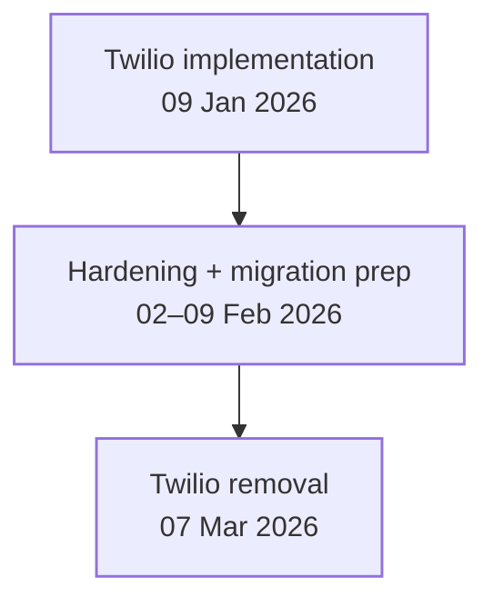

# DentSignal — the old Twilio chapter

DentSignal is a private voice-receptionist project. This repository is **not the receptionist**. It's a set of sanitized files from an earlier Twilio implementation — the bits that show how I handled calls, TwiML prompts, callbacks, and phone numbers at that time.

I kept them public because "I worked on phone systems" is a lot less interesting than seeing actual phone-system code.

## What you can open

- [Voice flow](evidence/twilio_voice_flow.py): outbound call creation, speech gathering, status lookups, and callback wiring.
- [Number provisioning](evidence/twilio_number_provisioning.py): search/purchase/release helpers and webhook configuration.
- [Admin routes](evidence/admin_number_routes.py): the earlier FastAPI-facing number operations.
- [Setup notes](evidence/historical_setup_notes.md): assumptions from that implementation period.
- [Migration notes](evidence/security_and_migration.md): hardening and removal history.

The [evidence map](EVIDENCE_MAP.md) labels what each extract supports and what it doesn't. That's the best place to start rather than treating a filename as proof of an entire deployed system.

## How the phone code changed

The public files capture that earlier implementation and its removal. They aren't the current telephony architecture.

## What was left out on purpose

Credentials, real clinic data, private identifiers, complete dependencies, auth wiring, persistence, and unrelated application code. The extracts are **not standalone or deployable**, and they don't establish today's provider, current architecture, customer outcomes, or uptime.

The included CircleCI configuration covers compilation/publication hygiene; its presence doesn't prove a current production voice service. Read [PROVENANCE.md](PROVENANCE.md) and [SECURITY.md](SECURITY.md) before drawing conclusions from the snippets.
